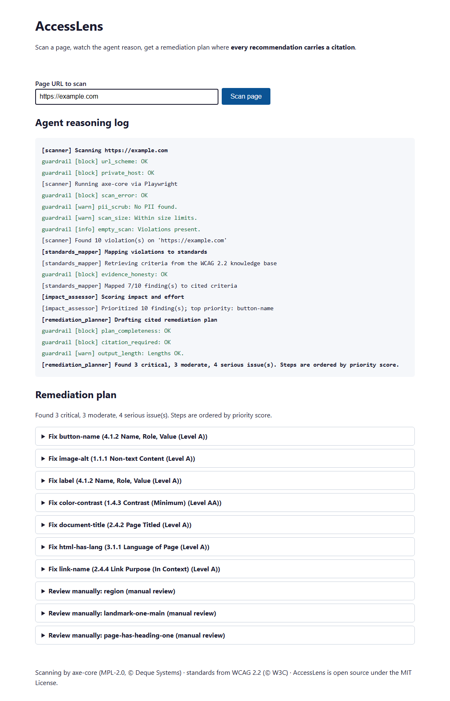

# AccessLens

**Scan any web page for accessibility problems, watch the agent reason through
them, and get a remediation plan where every recommendation carries a citation —
or is honestly flagged for manual review. No cloud account, no API key.**

AccessLens loads a page in a real browser, runs the industry-standard
[axe-core](https://github.com/dequelabs/axe-core) engine against it, maps each
violation to a specific [WCAG 2.2](https://www.w3.org/TR/WCAG22/) success
criterion, prioritises the findings, and drafts concrete fixes with code
snippets and links to the exact standard. The whole pipeline runs locally.



## Why it's different

Most accessibility checkers hand you a flat list of rule violations. AccessLens
adds the reasoning a human expert would:

- **Grounded, not guessed.** Every fix is tied to a cited WCAG 2.2 criterion.
  When no criterion backs a finding (e.g. an axe best-practice rule), the tool
  says *"insufficient evidence — manual review"* instead of inventing a
  justification. A guardrail enforces this; it is not optional.
- **Observable reasoning.** The four pipeline stages stream to the UI live, so
  you watch it scan → map → prioritise → plan, including every safety check.
- **Deterministic and auditable.** Prioritisation uses a documented formula, not
  a black box, so the same page always yields the same plan.

## Quick start

Requires Python 3.12+ and [uv](https://docs.astral.sh/uv/).

```bash
uv sync
uv run playwright install chromium      # one-time: download the headless browser
uv run uvicorn accesslens.web.app:app   # serve at http://localhost:8000
```

Open <http://localhost:8000>, enter a URL (it defaults to `https://example.com`),
and press **Scan page**.

### Offline / demo mode

To replay a bundled scan with no network at all — useful for a quick look or for
CI — set one environment variable:

```bash
ACCESSLENS_MOCK=1 uv run uvicorn accesslens.web.app:app
```

In this mode the pipeline loads a recorded scan of a deliberately broken page and
runs the full reasoning chain offline.

## How it works

A four-stage typed pipeline, with a guardrail at every boundary:

1. **Scanner** — Playwright opens the page, injects axe-core, returns a typed
   `ScanReport` of violations. Failures (unreachable host, timeout) come back as
   a report with an `error` set; the agent never crashes.
2. **StandardsMapper** — maps each violation's WCAG tags to success criteria and
   attaches citations from the bundled knowledge base. No match → the finding is
   flagged `insufficient_evidence`.
3. **ImpactAssessor** — scores each finding by
   `impact_weight × (1 + min(affected_nodes, 10) / 10)` and sorts by priority.
4. **RemediationPlanner** — writes a cited step (with a code suggestion) for each
   grounded finding, and an honest "manual review" step for each ungrounded one.

The 10 guardrail rules — including an SSRF guard on the target URL, PII scrubbing
of captured HTML, and the citation-required rule — are documented in
[`docs/architecture.md`](docs/architecture.md), along with the architecture
diagram and the full priority formula.

## Configuration

| Variable | Default | Effect |
|---|---|---|
| `ACCESSLENS_MOCK` | `0` | `1` replays a bundled scan offline instead of scanning the entered URL |
| `ACCESSLENS_ALLOW_LOCAL` | `0` | `1` permits scanning `localhost` / private hosts (off by default as an SSRF guard) |

## Project layout

```
src/accesslens/
  models.py        Pydantic contracts passed between stages
  scanner.py       Playwright + axe-core scan tool
  data.py          LocalRetriever + WCAG tag parsing (the knowledge tier)
  data/            WCAG 2.2 criteria + per-rule effort (JSON)
  stages.py        StandardsMapper, ImpactAssessor, RemediationPlanner
  guardrails.py    10-rule guardrails pipeline
  pipeline.py      orchestrator: runs the stages, streams events
  config.py        runtime settings
  web/app.py       FastAPI app + Server-Sent Events endpoint
  web/static/      accessibility-first single-page UI
tests/             pytest suite (unit + a browser-marked scanner test)
```

## Testing

```bash
uv run pytest                 # full suite
uv run pytest -m "not browser"  # skip the test that needs Chromium
```

The suite covers the contracts, the WCAG lookup, every guardrail rule, the three
stages, the orchestrator (offline), and the HTTP/SSE layer. The UI is held to its
own standard: it passes an axe-core scan of itself with zero violations.

## Extending it

The stages depend on a small `Retriever` protocol (`lookup` + `effort`), so the
local WCAG tier can be swapped for a hosted LLM, a vector store, or an enterprise
knowledge base without touching any stage. See the protocol in
`src/accesslens/data.py`.

## Credits & license

AccessLens is released under the [MIT License](LICENSE). It bundles
[axe-core](https://github.com/dequelabs/axe-core) (MPL-2.0, © Deque Systems) and
uses success-criteria text derived from [WCAG 2.2](https://www.w3.org/TR/WCAG22/)
(© W3C). It was originally prototyped for the Microsoft Agents League and then
finished as a standalone, cloud-free tool.
