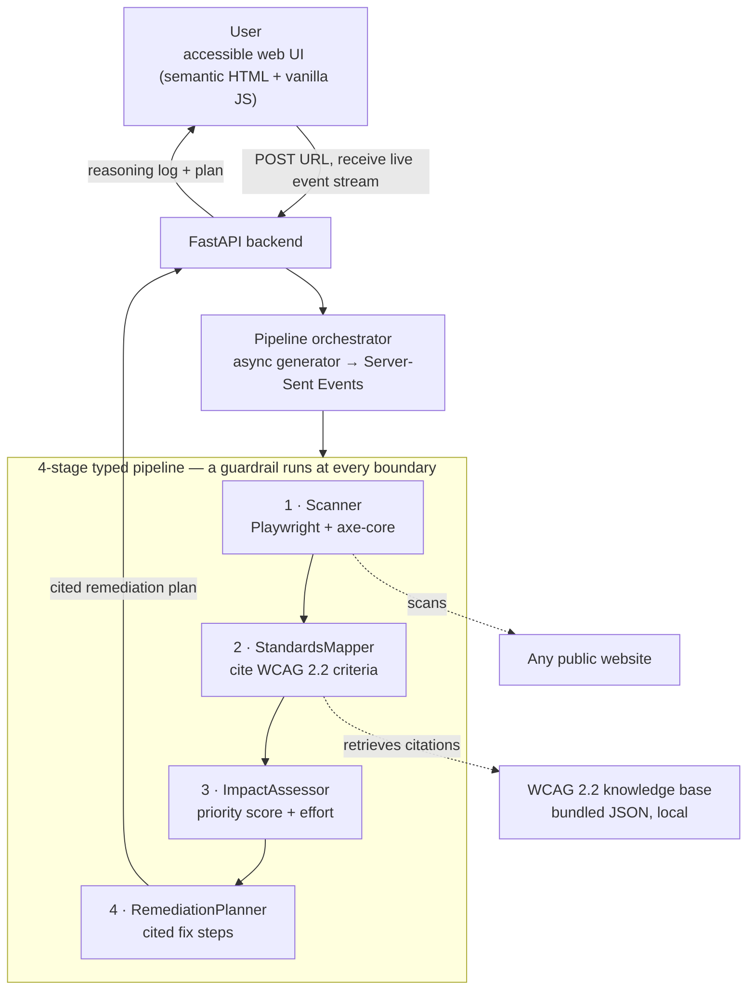

# AccessLens architecture

AccessLens runs entirely on your machine. Scanning (Playwright + axe-core) and
standards grounding (a bundled WCAG 2.2 knowledge base) are both local — no
cloud account, API key, or network service is required beyond reaching the site
you choose to scan.



## Typed contracts

Every stage consumes exactly one Pydantic model and produces exactly one, so
each handoff is schema-validated and the reasoning chain is observable:

`ScanReport` → `MappedFindings` → `PrioritizedFindings` → `RemediationPlan`

## Guardrails

A guardrails pipeline runs at four named boundaries. Rules are `BLOCK`
(halt with a user-readable reason), `WARN` (transform/annotate, continue), or
`INFO`.

| Boundary | Rule | Severity | Purpose |
|---|---|---|---|
| `pre_scan` | `url_scheme` | BLOCK | only http/https can be scanned |
| `pre_scan` | `private_host` | BLOCK | SSRF guard: no localhost/private IPs unless explicitly allowed |
| `post_scan` | `scan_error` | BLOCK | stop cleanly if the scan failed |
| `post_scan` | `pii_scrub` | WARN | redact emails/phones from captured HTML snippets |
| `post_scan` | `scan_size` | WARN | cap the number of violations processed |
| `post_scan` | `empty_scan` | INFO | note when a page passes automated checks |
| `post_map` | `evidence_honesty` | BLOCK | a finding with no citation must be flagged "insufficient evidence" |
| `post_plan` | `plan_completeness` | BLOCK | the plan must carry a summary |
| `post_plan` | `citation_required` | BLOCK | no recommendation may ship without a citation or an honest "manual review" flag |
| `post_plan` | `output_length` | WARN | clip overlong recommendation text |

The two italicised promises — `evidence_honesty` and `citation_required` — are
what stop the tool from inventing fixes. Every recommendation is either grounded
in a cited WCAG criterion or openly marked for manual review.

## Priority formula

`ImpactAssessor` scores each finding deterministically (documented so results
are auditable, not a black box):

```
priority_score = impact_weight × (1 + min(affected_nodes, 10) / 10)

impact_weight:  minor = 1,  moderate = 2,  serious = 3,  critical = 4
```

Findings are then sorted by descending score. Effort (`quick` / `moderate` /
`involved`) comes from a per-rule table.

## Extending the knowledge tier

`StandardsMapper`, `ImpactAssessor`, and `RemediationPlanner` each receive a
`Retriever` (see `src/accesslens/data.py`). The bundled `LocalRetriever` is the
default. Any alternate source — a hosted LLM, a vector store, an enterprise
knowledge base — becomes a drop-in by implementing the same two-method protocol;
no stage or pipeline code changes.
