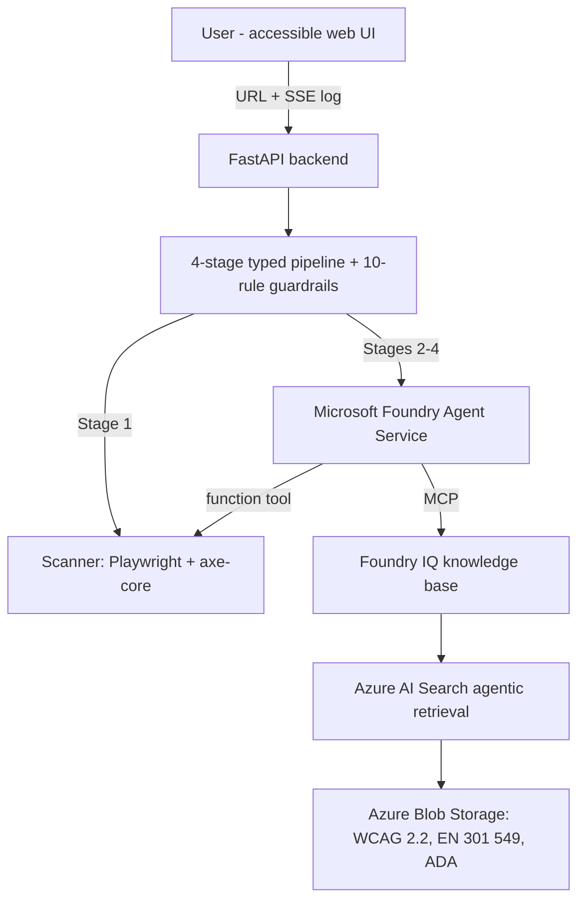

# AccessLens Implementation Plan

> **For agentic workers:** REQUIRED SUB-SKILL: Use superpowers:subagent-driven-development (recommended) or superpowers:executing-plans to implement this plan task-by-task. Steps use checkbox (`- [ ]`) syntax for tracking.

**Goal:** Build AccessLens — a Microsoft Foundry reasoning agent that scans websites for accessibility violations and produces citation-backed remediation plans grounded in a Foundry IQ knowledge base — submitted to the Agents League contest by June 14, 2026.

**Architecture:** A 4-stage typed pipeline (Scanner → StandardsMapper → ImpactAssessor → RemediationPlanner) with Pydantic contracts and a guardrails pipeline at every boundary, orchestrated by FastAPI and streamed to an accessibility-first UI via SSE. Stages use a swappable retriever/writer interface: a deterministic local tier (works offline, zero credentials) and a Foundry + Foundry IQ live tier (Phase B, gated on Azure access).

**Tech Stack:** Python 3.12, uv, Pydantic v2, Playwright + axe-core (vendored), FastAPI + SSE, pytest; Phase B: azure-ai-projects v2, Foundry Agent Service, Foundry IQ knowledge base (MCP), Azure Blob Storage.

**Repo root:** `Z:\Claude\Projects\Microsoft AI Agents Hackathon\accesslens` (all paths below relative to this). Work on branch `feat/design-spec` or a new `feat/build` branch — never `main` (hook-enforced).

---

## Phase A — Azure-free (June 12, tonight)

### Task 1: Project scaffold

**Files:**
- Create: `pyproject.toml`, `.gitignore`, `.env.example`, `src/accesslens/__init__.py`, `tests/__init__.py`, `scripts/fetch_axe.py`

- [ ] **Step 1: Write `pyproject.toml`**

```toml
[project]
name = "accesslens"
version = "0.1.0"
description = "Accessibility compliance navigator: scan, reason, remediate - with citations."
requires-python = ">=3.12"
dependencies = [
    "fastapi>=0.115",
    "uvicorn>=0.30",
    "pydantic>=2.7",
    "playwright>=1.47",
    "httpx>=0.27",
]

[project.optional-dependencies]
azure = [
    "azure-ai-projects>=2.0.0",
    "azure-identity>=1.17",
    "openai>=1.40",
]

[dependency-groups]
dev = ["pytest>=8", "pytest-asyncio>=0.24"]

[build-system]
requires = ["hatchling"]
build-backend = "hatchling.build"

[tool.hatch.build.targets.wheel]
packages = ["src/accesslens"]

[tool.pytest.ini_options]
asyncio_mode = "auto"
testpaths = ["tests"]
markers = ["browser: requires installed Playwright Chromium"]
```

- [ ] **Step 2: Write `.gitignore`**

```gitignore
__pycache__/
*.pyc
.venv/
.env
.pytest_cache/
dist/
*.png.tmp
```

- [ ] **Step 3: Write `.env.example`**

```dotenv
# Mock mode: 1 = full pipeline offline, zero credentials (default for judges)
ACCESSLENS_MOCK=1
# Allow scanning localhost/private hosts (needed for the self-scan demo)
ACCESSLENS_ALLOW_LOCAL=0

# --- Phase B (Azure live mode) ---
FOUNDRY_PROJECT_ENDPOINT=
FOUNDRY_MODEL=gpt-4o-mini
```

- [ ] **Step 4: Create package and test skeletons**

`src/accesslens/__init__.py`:

```python
"""AccessLens: accessibility compliance navigator with cited remediation plans."""

__version__ = "0.1.0"
```

`tests/__init__.py`: empty file.

- [ ] **Step 5: Write `scripts/fetch_axe.py` (vendor axe-core)**

```python
"""Download axe-core into the package so scans work offline.

axe-core is MPL-2.0 licensed (c) Deque Systems - attribution kept in README.
"""

import urllib.request
from pathlib import Path

AXE_URL = "https://cdn.jsdelivr.net/npm/axe-core@4.10.2/axe.min.js"
DEST = Path(__file__).parent.parent / "src" / "accesslens" / "web" / "static" / "vendor" / "axe.min.js"


def main() -> None:
    DEST.parent.mkdir(parents=True, exist_ok=True)
    print(f"Downloading {AXE_URL} -> {DEST}")
    urllib.request.urlretrieve(AXE_URL, DEST)
    size_kb = DEST.stat().st_size // 1024
    print(f"Done ({size_kb} KB)")


if __name__ == "__main__":
    main()
```

- [ ] **Step 6: Install and verify**

Run:
```powershell
uv sync --all-extras
uv run python scripts/fetch_axe.py
uv run playwright install chromium
uv run pytest --collect-only
```
Expected: deps resolve; `axe.min.js` downloaded (~500 KB); Chromium installed; pytest collects 0 tests without error.

- [ ] **Step 7: Commit**

```powershell
git add -A
git commit -m "chore: scaffold accesslens project with uv, vendored axe-core"
```

---

### Task 2: Pydantic contracts (`models.py`)

**Files:**
- Create: `src/accesslens/models.py`
- Test: `tests/test_models.py`

- [ ] **Step 1: Write the failing tests**

`tests/test_models.py`:

```python
from datetime import datetime, timezone

from accesslens.models import (
    IMPACT_WEIGHT,
    AxeViolation,
    CitationRef,
    Impact,
    MappedFinding,
    PipelineEvent,
    EventType,
    RemediationPlan,
    RemediationStep,
    ScanReport,
)


def test_impact_weights_are_ordered():
    assert (
        IMPACT_WEIGHT[Impact.MINOR]
        < IMPACT_WEIGHT[Impact.MODERATE]
        < IMPACT_WEIGHT[Impact.SERIOUS]
        < IMPACT_WEIGHT[Impact.CRITICAL]
    )


def test_scan_report_roundtrip():
    report = ScanReport(
        url="https://example.org",
        scanned_at=datetime.now(timezone.utc),
        violations=[
            AxeViolation(
                rule_id="image-alt",
                impact=Impact.CRITICAL,
                description="Images must have alternate text",
                help_url="https://dequeuniversity.com/rules/axe/4.10/image-alt",
                wcag_tags=["wcag2a", "wcag111"],
            )
        ],
    )
    restored = ScanReport.model_validate_json(report.model_dump_json())
    assert restored.violations[0].rule_id == "image-alt"


def test_mapped_finding_defaults_to_evidence_present():
    finding = MappedFinding(
        rule_id="image-alt", impact=Impact.CRITICAL, summary="Missing alt text"
    )
    assert finding.insufficient_evidence is False
    assert finding.standard_refs == []


def test_remediation_plan_holds_cited_steps():
    plan = RemediationPlan(
        url="https://example.org",
        generated_at=datetime.now(timezone.utc),
        summary="1 critical issue",
        steps=[
            RemediationStep(
                rule_id="image-alt",
                title="Add alt text",
                recommendation="Provide a text alternative for every informative image.",
                citations=[
                    CitationRef(source_id="wcag22", section="1.1.1 Non-text Content")
                ],
            )
        ],
    )
    assert plan.steps[0].citations[0].section.startswith("1.1.1")


def test_pipeline_event_serializes_for_sse():
    event = PipelineEvent(stage="scanner", type=EventType.STAGE_START, message="Scanning")
    data = event.model_dump_json()
    assert '"scanner"' in data and '"stage_start"' in data
```

- [ ] **Step 2: Run tests to verify they fail**

Run: `uv run pytest tests/test_models.py -v`
Expected: FAIL with `ModuleNotFoundError: No module named 'accesslens.models'`

- [ ] **Step 3: Write `src/accesslens/models.py`**

```python
"""Typed contracts for every pipeline boundary.

Each stage consumes exactly one of these models and produces exactly one,
so handoffs are schema-validated and the reasoning chain is observable.
"""

from __future__ import annotations

from datetime import datetime, timezone
from enum import Enum

from pydantic import BaseModel, Field


class Impact(str, Enum):
    MINOR = "minor"
    MODERATE = "moderate"
    SERIOUS = "serious"
    CRITICAL = "critical"


IMPACT_WEIGHT: dict[Impact, int] = {
    Impact.MINOR: 1,
    Impact.MODERATE: 2,
    Impact.SERIOUS: 3,
    Impact.CRITICAL: 4,
}


class NodeSnippet(BaseModel):
    target: str
    html: str


class AxeViolation(BaseModel):
    rule_id: str
    impact: Impact
    description: str
    help_url: str = ""
    wcag_tags: list[str] = Field(default_factory=list)
    nodes: list[NodeSnippet] = Field(default_factory=list)


class ScanReport(BaseModel):
    url: str
    page_title: str = ""
    scanned_at: datetime
    duration_ms: int = 0
    violations: list[AxeViolation] = Field(default_factory=list)
    error: str | None = None


class CitationRef(BaseModel):
    source_id: str
    section: str
    url: str = ""
    quote: str = ""


class MappedFinding(BaseModel):
    rule_id: str
    impact: Impact
    summary: str
    affected_nodes: int = 0
    standard_refs: list[CitationRef] = Field(default_factory=list)
    insufficient_evidence: bool = False


class MappedFindings(BaseModel):
    url: str
    findings: list[MappedFinding] = Field(default_factory=list)


class Effort(str, Enum):
    QUICK = "quick"
    MODERATE = "moderate"
    INVOLVED = "involved"


class PrioritizedFinding(BaseModel):
    finding: MappedFinding
    priority_score: float
    effort: Effort
    rationale: str


class PrioritizedFindings(BaseModel):
    url: str
    findings: list[PrioritizedFinding] = Field(default_factory=list)


class RemediationStep(BaseModel):
    rule_id: str
    title: str
    recommendation: str
    code_suggestion: str = ""
    citations: list[CitationRef] = Field(default_factory=list)
    insufficient_evidence: bool = False


class RemediationPlan(BaseModel):
    url: str
    generated_at: datetime
    summary: str
    steps: list[RemediationStep] = Field(default_factory=list)


class EventType(str, Enum):
    STAGE_START = "stage_start"
    TOOL_CALL = "tool_call"
    RETRIEVAL = "retrieval"
    GUARDRAIL = "guardrail"
    STAGE_RESULT = "stage_result"
    ERROR = "error"
    DONE = "done"


class PipelineEvent(BaseModel):
    stage: str
    type: EventType
    message: str
    timestamp: datetime = Field(default_factory=lambda: datetime.now(timezone.utc))
    payload: dict = Field(default_factory=dict)
```

- [ ] **Step 4: Run tests to verify they pass**

Run: `uv run pytest tests/test_models.py -v`
Expected: 5 passed

- [ ] **Step 5: Commit**

```powershell
git add src/accesslens/models.py tests/test_models.py
git commit -m "feat: add typed pipeline contracts (Pydantic v2)"
```

---

### Task 3: Local standards knowledge (`data.py` + JSON data)

This is the deterministic retrieval tier: axe WCAG tags → WCAG 2.2 success criteria with real citations. The Foundry IQ live tier (Phase B) implements the same `Retriever` interface.

**Files:**
- Create: `src/accesslens/data/wcag_criteria.json`, `src/accesslens/data/rule_effort.json`, `src/accesslens/data.py`
- Test: `tests/test_data.py`

- [ ] **Step 1: Write the failing tests**

`tests/test_data.py`:

```python
from accesslens.data import LocalRetriever, parse_wcag_tag


def test_parse_wcag_tag_three_digit():
    assert parse_wcag_tag("wcag111") == "1.1.1"


def test_parse_wcag_tag_four_digit():
    assert parse_wcag_tag("wcag1410") == "1.4.10"


def test_parse_wcag_tag_ignores_level_tags():
    assert parse_wcag_tag("wcag2a") is None
    assert parse_wcag_tag("wcag22aa") is None
    assert parse_wcag_tag("best-practice") is None


def test_local_retriever_returns_citations():
    retriever = LocalRetriever()
    refs = retriever.lookup(["wcag2a", "wcag111"])
    assert len(refs) == 1
    assert refs[0].section.startswith("1.1.1")
    assert refs[0].source_id == "wcag22"
    assert refs[0].url


def test_local_retriever_unknown_tag_returns_empty():
    retriever = LocalRetriever()
    assert retriever.lookup(["wcag999"]) == []


def test_effort_lookup_has_default():
    retriever = LocalRetriever()
    assert retriever.effort("color-contrast").value == "quick"
    assert retriever.effort("totally-unknown-rule").value == "moderate"
```

- [ ] **Step 2: Run tests to verify they fail**

Run: `uv run pytest tests/test_data.py -v`
Expected: FAIL with `ModuleNotFoundError`

- [ ] **Step 3: Write `src/accesslens/data/wcag_criteria.json`**

```json
{
  "1.1.1": {"name": "Non-text Content", "level": "A", "summary": "All non-text content has a text alternative that serves the equivalent purpose.", "url": "https://www.w3.org/WAI/WCAG22/Understanding/non-text-content.html"},
  "1.3.1": {"name": "Info and Relationships", "level": "A", "summary": "Information, structure, and relationships conveyed through presentation can be programmatically determined.", "url": "https://www.w3.org/WAI/WCAG22/Understanding/info-and-relationships.html"},
  "1.3.5": {"name": "Identify Input Purpose", "level": "AA", "summary": "The purpose of each input field collecting user information can be programmatically determined.", "url": "https://www.w3.org/WAI/WCAG22/Understanding/identify-input-purpose.html"},
  "1.4.1": {"name": "Use of Color", "level": "A", "summary": "Color is not used as the only visual means of conveying information or distinguishing elements.", "url": "https://www.w3.org/WAI/WCAG22/Understanding/use-of-color.html"},
  "1.4.2": {"name": "Audio Control", "level": "A", "summary": "Auto-playing audio longer than 3 seconds can be paused, stopped, or its volume controlled.", "url": "https://www.w3.org/WAI/WCAG22/Understanding/audio-control.html"},
  "1.4.3": {"name": "Contrast (Minimum)", "level": "AA", "summary": "Text and images of text have a contrast ratio of at least 4.5:1 (3:1 for large text).", "url": "https://www.w3.org/WAI/WCAG22/Understanding/contrast-minimum.html"},
  "1.4.4": {"name": "Resize Text", "level": "AA", "summary": "Text can be resized up to 200 percent without loss of content or functionality.", "url": "https://www.w3.org/WAI/WCAG22/Understanding/resize-text.html"},
  "1.4.10": {"name": "Reflow", "level": "AA", "summary": "Content reflows to a single column at 320 CSS pixels without two-dimensional scrolling.", "url": "https://www.w3.org/WAI/WCAG22/Understanding/reflow.html"},
  "1.4.11": {"name": "Non-text Contrast", "level": "AA", "summary": "UI components and graphical objects have a contrast ratio of at least 3:1 against adjacent colors.", "url": "https://www.w3.org/WAI/WCAG22/Understanding/non-text-contrast.html"},
  "1.4.12": {"name": "Text Spacing", "level": "AA", "summary": "No loss of content when users adjust line height, paragraph, letter, and word spacing.", "url": "https://www.w3.org/WAI/WCAG22/Understanding/text-spacing.html"},
  "2.1.1": {"name": "Keyboard", "level": "A", "summary": "All functionality is operable through a keyboard interface without requiring specific timings.", "url": "https://www.w3.org/WAI/WCAG22/Understanding/keyboard.html"},
  "2.4.1": {"name": "Bypass Blocks", "level": "A", "summary": "A mechanism is available to bypass blocks of content repeated on multiple pages.", "url": "https://www.w3.org/WAI/WCAG22/Understanding/bypass-blocks.html"},
  "2.4.2": {"name": "Page Titled", "level": "A", "summary": "Web pages have titles that describe topic or purpose.", "url": "https://www.w3.org/WAI/WCAG22/Understanding/page-titled.html"},
  "2.4.4": {"name": "Link Purpose (In Context)", "level": "A", "summary": "The purpose of each link can be determined from the link text or its context.", "url": "https://www.w3.org/WAI/WCAG22/Understanding/link-purpose-in-context.html"},
  "2.4.6": {"name": "Headings and Labels", "level": "AA", "summary": "Headings and labels describe topic or purpose.", "url": "https://www.w3.org/WAI/WCAG22/Understanding/headings-and-labels.html"},
  "2.4.7": {"name": "Focus Visible", "level": "AA", "summary": "Any keyboard-operable interface has a mode where the keyboard focus indicator is visible.", "url": "https://www.w3.org/WAI/WCAG22/Understanding/focus-visible.html"},
  "2.5.3": {"name": "Label in Name", "level": "A", "summary": "For components with visible text labels, the accessible name contains the visible text.", "url": "https://www.w3.org/WAI/WCAG22/Understanding/label-in-name.html"},
  "3.1.1": {"name": "Language of Page", "level": "A", "summary": "The default human language of each web page can be programmatically determined.", "url": "https://www.w3.org/WAI/WCAG22/Understanding/language-of-page.html"},
  "3.1.2": {"name": "Language of Parts", "level": "AA", "summary": "The human language of each passage can be programmatically determined.", "url": "https://www.w3.org/WAI/WCAG22/Understanding/language-of-parts.html"},
  "3.2.2": {"name": "On Input", "level": "A", "summary": "Changing a setting does not automatically cause a change of context unless the user is advised.", "url": "https://www.w3.org/WAI/WCAG22/Understanding/on-input.html"},
  "3.3.1": {"name": "Error Identification", "level": "A", "summary": "Input errors are identified and described to the user in text.", "url": "https://www.w3.org/WAI/WCAG22/Understanding/error-identification.html"},
  "3.3.2": {"name": "Labels or Instructions", "level": "A", "summary": "Labels or instructions are provided when content requires user input.", "url": "https://www.w3.org/WAI/WCAG22/Understanding/labels-or-instructions.html"},
  "4.1.2": {"name": "Name, Role, Value", "level": "A", "summary": "For all UI components, the name, role, states, and values can be programmatically determined and set.", "url": "https://www.w3.org/WAI/WCAG22/Understanding/name-role-value.html"},
  "4.1.3": {"name": "Status Messages", "level": "AA", "summary": "Status messages can be programmatically determined through role or properties without receiving focus.", "url": "https://www.w3.org/WAI/WCAG22/Understanding/status-messages.html"}
}
```

- [ ] **Step 4: Write `src/accesslens/data/rule_effort.json`**

```json
{
  "_default": "moderate",
  "image-alt": "quick",
  "color-contrast": "quick",
  "html-has-lang": "quick",
  "html-lang-valid": "quick",
  "document-title": "quick",
  "button-name": "quick",
  "link-name": "quick",
  "label": "quick",
  "meta-viewport": "quick",
  "region": "moderate",
  "landmark-one-main": "moderate",
  "page-has-heading-one": "moderate",
  "heading-order": "moderate",
  "aria-required-attr": "moderate",
  "aria-roles": "moderate",
  "frame-title": "quick",
  "tabindex": "moderate",
  "scrollable-region-focusable": "involved",
  "nested-interactive": "involved"
}
```

- [ ] **Step 5: Write `src/accesslens/data.py`**

```python
"""Local standards knowledge: the deterministic retrieval tier.

The Foundry IQ live tier (Phase B) implements the same ``Retriever``
protocol, so stages never know which tier served them.
"""

from __future__ import annotations

import json
import re
from functools import lru_cache
from pathlib import Path
from typing import Protocol

from accesslens.models import CitationRef, Effort

DATA_DIR = Path(__file__).parent / "data"
WCAG_TAG_RE = re.compile(r"^wcag(\d)(\d)(\d+)$")


def parse_wcag_tag(tag: str) -> str | None:
    """Convert an axe-core tag like ``wcag111`` to an SC number like ``1.1.1``.

    Level tags (``wcag2a``, ``wcag22aa``) and non-WCAG tags return None.
    """
    match = WCAG_TAG_RE.match(tag)
    if match is None:
        return None
    principle, guideline, criterion = match.groups()
    return f"{principle}.{guideline}.{criterion}"


@lru_cache(maxsize=1)
def _load_criteria() -> dict[str, dict]:
    return json.loads((DATA_DIR / "wcag_criteria.json").read_text(encoding="utf-8"))


@lru_cache(maxsize=1)
def _load_efforts() -> dict[str, str]:
    return json.loads((DATA_DIR / "rule_effort.json").read_text(encoding="utf-8"))


class Retriever(Protocol):
    """Interface shared by the local tier and the Foundry IQ tier."""

    def lookup(self, wcag_tags: list[str]) -> list[CitationRef]: ...

    def effort(self, rule_id: str) -> Effort: ...


class LocalRetriever:
    """Deterministic lookup against bundled WCAG 2.2 criteria data."""

    def lookup(self, wcag_tags: list[str]) -> list[CitationRef]:
        criteria = _load_criteria()
        refs: list[CitationRef] = []
        for tag in wcag_tags:
            sc_number = parse_wcag_tag(tag)
            if sc_number is None or sc_number not in criteria:
                continue
            entry = criteria[sc_number]
            refs.append(
                CitationRef(
                    source_id="wcag22",
                    section=f"{sc_number} {entry['name']} (Level {entry['level']})",
                    url=entry["url"],
                    quote=entry["summary"],
                )
            )
        return refs

    def effort(self, rule_id: str) -> Effort:
        efforts = _load_efforts()
        return Effort(efforts.get(rule_id, efforts["_default"]))
```

Note: `wcag999` parses to SC "9.9.9" which is absent from the data file, so it returns `[]` — that's the unknown-tag test path.

- [ ] **Step 6: Run tests to verify they pass**

Run: `uv run pytest tests/test_data.py -v`
Expected: 6 passed

- [ ] **Step 7: Commit**

```powershell
git add src/accesslens/data.py src/accesslens/data tests/test_data.py
git commit -m "feat: add local WCAG 2.2 knowledge tier with shared Retriever protocol"
```

---

### Task 4: Guardrails pipeline (`guardrails.py`)

10 named rules, severities BLOCK/WARN/INFO, run at named boundaries. BLOCK raises; every result is reportable to the UI log.

**Files:**
- Create: `src/accesslens/guardrails.py`
- Test: `tests/test_guardrails.py`

- [ ] **Step 1: Write the failing tests**

`tests/test_guardrails.py`:

```python
from datetime import datetime, timezone

import pytest

from accesslens.guardrails import GuardrailBlocked, GuardrailsPipeline, Severity
from accesslens.models import (
    AxeViolation,
    CitationRef,
    Impact,
    MappedFinding,
    MappedFindings,
    NodeSnippet,
    RemediationPlan,
    RemediationStep,
    ScanReport,
)


def make_report(**kwargs) -> ScanReport:
    defaults = dict(url="https://example.org", scanned_at=datetime.now(timezone.utc))
    defaults.update(kwargs)
    return ScanReport(**defaults)


def test_pre_scan_blocks_file_scheme():
    pipeline = GuardrailsPipeline(allow_local=False)
    with pytest.raises(GuardrailBlocked):
        pipeline.run("pre_scan", "file:///etc/passwd")


def test_pre_scan_blocks_private_host():
    pipeline = GuardrailsPipeline(allow_local=False)
    with pytest.raises(GuardrailBlocked):
        pipeline.run("pre_scan", "http://192.168.1.1/admin")
    with pytest.raises(GuardrailBlocked):
        pipeline.run("pre_scan", "http://localhost:8000")


def test_pre_scan_allows_localhost_when_configured():
    pipeline = GuardrailsPipeline(allow_local=True)
    url, results = pipeline.run("pre_scan", "http://localhost:8000")
    assert url == "http://localhost:8000"
    assert all(r.passed for r in results)


def test_post_scan_scrubs_pii_from_snippets():
    pipeline = GuardrailsPipeline()
    report = make_report(
        violations=[
            AxeViolation(
                rule_id="label",
                impact=Impact.SERIOUS,
                description="d",
                nodes=[NodeSnippet(target="#x", html='<input value="bob@example.com">')],
            )
        ]
    )
    scrubbed, results = pipeline.run("post_scan", report)
    assert "bob@example.com" not in scrubbed.violations[0].nodes[0].html
    assert any(r.rule == "pii_scrub" for r in results)


def test_post_scan_empty_scan_is_info_not_block():
    pipeline = GuardrailsPipeline()
    report, results = pipeline.run("post_scan", make_report(violations=[]))
    empty = [r for r in results if r.rule == "empty_scan"]
    assert empty and empty[0].severity == Severity.INFO


def test_post_map_blocks_dishonest_finding():
    pipeline = GuardrailsPipeline()
    findings = MappedFindings(
        url="https://example.org",
        findings=[
            MappedFinding(
                rule_id="x",
                impact=Impact.MINOR,
                summary="no refs but claims evidence",
                standard_refs=[],
                insufficient_evidence=False,
            )
        ],
    )
    with pytest.raises(GuardrailBlocked):
        pipeline.run("post_map", findings)


def test_post_plan_blocks_uncited_recommendation():
    pipeline = GuardrailsPipeline()
    plan = RemediationPlan(
        url="https://example.org",
        generated_at=datetime.now(timezone.utc),
        summary="s",
        steps=[RemediationStep(rule_id="x", title="t", recommendation="do things")],
    )
    with pytest.raises(GuardrailBlocked):
        pipeline.run("post_plan", plan)


def test_post_plan_passes_cited_or_honest_steps():
    pipeline = GuardrailsPipeline()
    plan = RemediationPlan(
        url="https://example.org",
        generated_at=datetime.now(timezone.utc),
        summary="s",
        steps=[
            RemediationStep(
                rule_id="a",
                title="cited",
                recommendation="fix per standard",
                citations=[CitationRef(source_id="wcag22", section="1.1.1")],
            ),
            RemediationStep(
                rule_id="b",
                title="honest",
                recommendation="needs manual review",
                insufficient_evidence=True,
            ),
        ],
    )
    checked, results = pipeline.run("post_plan", plan)
    assert checked is plan
```

- [ ] **Step 2: Run tests to verify they fail**

Run: `uv run pytest tests/test_guardrails.py -v`
Expected: FAIL with `ModuleNotFoundError`

- [ ] **Step 3: Write `src/accesslens/guardrails.py`**

```python
"""Guardrails pipeline: named rules enforced at every stage boundary.

Severities: BLOCK halts the pipeline with a user-readable reason,
WARN transforms or annotates and continues, INFO is purely informational.
"""

from __future__ import annotations

import ipaddress
import re
import urllib.parse
from enum import Enum
from typing import Any, Callable

from pydantic import BaseModel

from accesslens.models import MappedFindings, RemediationPlan, ScanReport

MAX_VIOLATIONS = 200
MAX_TEXT_LEN = 2000
EMAIL_RE = re.compile(r"[\w.+-]+@[\w-]+\.[\w.-]+")
PHONE_RE = re.compile(r"\+?\d[\d\s().-]{7,}\d")
PRIVATE_HOSTS = {"localhost", "127.0.0.1", "0.0.0.0", "::1"}


class Severity(str, Enum):
    BLOCK = "block"
    WARN = "warn"
    INFO = "info"


class RuleResult(BaseModel):
    rule: str
    severity: Severity
    passed: bool
    message: str = ""


class GuardrailBlocked(Exception):
    def __init__(self, result: RuleResult):
        self.result = result
        super().__init__(f"[{result.rule}] {result.message}")


Rule = Callable[[Any], tuple[Any, RuleResult]]


def _is_private_host(host: str) -> bool:
    if host.lower() in PRIVATE_HOSTS:
        return True
    try:
        return ipaddress.ip_address(host).is_private
    except ValueError:
        return False


def url_scheme_rule(url: str) -> tuple[str, RuleResult]:
    scheme = urllib.parse.urlparse(url).scheme
    ok = scheme in ("http", "https")
    return url, RuleResult(
        rule="url_scheme",
        severity=Severity.BLOCK,
        passed=ok,
        message="OK" if ok else f"Only http/https URLs can be scanned (got '{scheme or 'none'}').",
    )


def make_private_host_rule(allow_local: bool) -> Rule:
    def private_host_rule(url: str) -> tuple[str, RuleResult]:
        host = urllib.parse.urlparse(url).hostname or ""
        private = _is_private_host(host)
        ok = allow_local or not private
        return url, RuleResult(
            rule="private_host",
            severity=Severity.BLOCK,
            passed=ok,
            message="OK" if ok else "Scanning private or local hosts is disabled (SSRF guard).",
        )

    return private_host_rule


def pii_scrub_rule(report: ScanReport) -> tuple[ScanReport, RuleResult]:
    scrubbed = 0
    for violation in report.violations:
        for node in violation.nodes:
            cleaned = EMAIL_RE.sub("[email]", node.html)
            cleaned = PHONE_RE.sub("[phone]", cleaned)
            if cleaned != node.html:
                node.html = cleaned
                scrubbed += 1
    return report, RuleResult(
        rule="pii_scrub",
        severity=Severity.WARN,
        passed=True,
        message=f"Scrubbed PII from {scrubbed} snippet(s)." if scrubbed else "No PII found.",
    )


def scan_size_rule(report: ScanReport) -> tuple[ScanReport, RuleResult]:
    truncated = len(report.violations) > MAX_VIOLATIONS
    if truncated:
        report.violations = report.violations[:MAX_VIOLATIONS]
    return report, RuleResult(
        rule="scan_size",
        severity=Severity.WARN,
        passed=True,
        message=f"Truncated to {MAX_VIOLATIONS} violations." if truncated else "Within size limits.",
    )


def empty_scan_rule(report: ScanReport) -> tuple[ScanReport, RuleResult]:
    empty = not report.violations and report.error is None
    return report, RuleResult(
        rule="empty_scan",
        severity=Severity.INFO,
        passed=True,
        message="No violations detected - the page passes automated checks." if empty else "Violations present.",
    )


def scan_error_rule(report: ScanReport) -> tuple[ScanReport, RuleResult]:
    ok = report.error is None
    return report, RuleResult(
        rule="scan_error",
        severity=Severity.BLOCK,
        passed=ok,
        message="OK" if ok else f"Scan failed: {report.error}",
    )


def evidence_honesty_rule(findings: MappedFindings) -> tuple[MappedFindings, RuleResult]:
    dishonest = [
        f.rule_id
        for f in findings.findings
        if not f.standard_refs and not f.insufficient_evidence
    ]
    ok = not dishonest
    return findings, RuleResult(
        rule="evidence_honesty",
        severity=Severity.BLOCK,
        passed=ok,
        message="OK" if ok else f"Findings without evidence must be flagged: {dishonest}",
    )


def citation_required_rule(plan: RemediationPlan) -> tuple[RemediationPlan, RuleResult]:
    uncited = [
        s.rule_id for s in plan.steps if not s.citations and not s.insufficient_evidence
    ]
    ok = not uncited
    return plan, RuleResult(
        rule="citation_required",
        severity=Severity.BLOCK,
        passed=ok,
        message="OK" if ok else f"Recommendations without citations are not allowed: {uncited}",
    )


def output_length_rule(plan: RemediationPlan) -> tuple[RemediationPlan, RuleResult]:
    clipped = 0
    for step in plan.steps:
        if len(step.recommendation) > MAX_TEXT_LEN:
            step.recommendation = step.recommendation[:MAX_TEXT_LEN] + "..."
            clipped += 1
    return plan, RuleResult(
        rule="output_length",
        severity=Severity.WARN,
        passed=True,
        message=f"Clipped {clipped} overlong step(s)." if clipped else "Lengths OK.",
    )


def plan_completeness_rule(plan: RemediationPlan) -> tuple[RemediationPlan, RuleResult]:
    ok = bool(plan.summary)
    return plan, RuleResult(
        rule="plan_completeness",
        severity=Severity.BLOCK,
        passed=ok,
        message="OK" if ok else "Plan must include a summary.",
    )


class GuardrailsPipeline:
    """Runs the registered rules for a named boundary, in order."""

    def __init__(self, allow_local: bool = False):
        self.boundaries: dict[str, list[Rule]] = {
            "pre_scan": [url_scheme_rule, make_private_host_rule(allow_local)],
            "post_scan": [scan_error_rule, pii_scrub_rule, scan_size_rule, empty_scan_rule],
            "post_map": [evidence_honesty_rule],
            "post_plan": [plan_completeness_rule, citation_required_rule, output_length_rule],
        }

    def run(self, boundary: str, payload: Any) -> tuple[Any, list[RuleResult]]:
        results: list[RuleResult] = []
        for rule in self.boundaries[boundary]:
            payload, result = rule(payload)
            results.append(result)
            if result.severity == Severity.BLOCK and not result.passed:
                raise GuardrailBlocked(result)
        return payload, results
```

- [ ] **Step 4: Run tests to verify they pass**

Run: `uv run pytest tests/test_guardrails.py -v`
Expected: 8 passed

- [ ] **Step 5: Commit**

```powershell
git add src/accesslens/guardrails.py tests/test_guardrails.py
git commit -m "feat: add 10-rule guardrails pipeline with BLOCK/WARN/INFO severities"
```

---

### Task 5: Scanner (Playwright + axe-core)

**Files:**
- Create: `src/accesslens/scanner.py`, `tests/fixtures/broken_page.html`
- Test: `tests/test_scanner.py`

- [ ] **Step 1: Write the deliberately broken fixture page**

`tests/fixtures/broken_page.html`:

```html
<!DOCTYPE html>
<html>
<head>
  <meta charset="utf-8">
  <style>
    .lowcontrast { color: #999999; background: #ffffff; }
  </style>
</head>
<body>
  
  <p class="lowcontrast">Hard to read text with poor contrast.</p>
  <input type="text">
  <button></button>
  <a href="page2.html"></a>
</body>
</html>
```

Intentional violations: no `<title>` (document-title), no `lang` on `<html>` (html-has-lang), image without alt (image-alt), low-contrast text (color-contrast), unlabeled input (label), empty button (button-name), empty link (link-name).

- [ ] **Step 2: Write the failing tests**

`tests/test_scanner.py`:

```python
from pathlib import Path

import pytest

from accesslens.scanner import scan_url

FIXTURE = Path(__file__).parent / "fixtures" / "broken_page.html"


@pytest.mark.browser
async def test_scan_finds_known_violations():
    report = await scan_url(FIXTURE.as_uri(), bypass_url_guard=True)
    assert report.error is None
    rule_ids = {v.rule_id for v in report.violations}
    assert "image-alt" in rule_ids
    assert "html-has-lang" in rule_ids
    assert "label" in rule_ids
    image_alt = next(v for v in report.violations if v.rule_id == "image-alt")
    assert image_alt.nodes and image_alt.nodes[0].html


@pytest.mark.browser
async def test_scan_unreachable_url_returns_error_report():
    report = await scan_url("http://nonexistent.invalid.example", timeout_s=10)
    assert report.error is not None
    assert report.violations == []
```

- [ ] **Step 3: Run tests to verify they fail**

Run: `uv run pytest tests/test_scanner.py -v`
Expected: FAIL with `ModuleNotFoundError`

- [ ] **Step 4: Write `src/accesslens/scanner.py`**

```python
"""Website scanning: Playwright loads the page, injected axe-core finds violations.

This is the agent's function tool in live mode and the pipeline's first
stage in every mode. Failures never raise - they come back as a
``ScanReport`` with ``error`` set, so the agent can explain them.
"""

from __future__ import annotations

import logging
import time
from datetime import datetime, timezone
from pathlib import Path

from playwright.async_api import async_playwright

from accesslens.models import AxeViolation, Impact, NodeSnippet, ScanReport

logger = logging.getLogger(__name__)

AXE_PATH = Path(__file__).parent / "web" / "static" / "vendor" / "axe.min.js"
MAX_NODES_PER_VIOLATION = 5


def _to_violation(raw: dict) -> AxeViolation:
    return AxeViolation(
        rule_id=raw["id"],
        impact=Impact(raw.get("impact") or "moderate"),
        description=raw.get("description", ""),
        help_url=raw.get("helpUrl", ""),
        wcag_tags=[t for t in raw.get("tags", []) if t.startswith("wcag")],
        nodes=[
            NodeSnippet(target=", ".join(map(str, n.get("target", []))), html=n.get("html", ""))
            for n in raw.get("nodes", [])[:MAX_NODES_PER_VIOLATION]
        ],
    )


async def scan_url(url: str, timeout_s: int = 30, bypass_url_guard: bool = False) -> ScanReport:
    """Scan ``url`` with axe-core and return a structured report.

    ``bypass_url_guard`` exists only for tests that scan file:// fixtures;
    production callers go through the guardrails pipeline first.
    """
    started = time.monotonic()
    scanned_at = datetime.now(timezone.utc)
    if not bypass_url_guard and not url.startswith(("http://", "https://")):
        return ScanReport(url=url, scanned_at=scanned_at, error="URL must be http(s).")
    try:
        async with async_playwright() as pw:
            browser = await pw.chromium.launch(headless=True)
            try:
                page = await browser.new_page()
                await page.goto(url, timeout=timeout_s * 1000, wait_until="domcontentloaded")
                await page.add_script_tag(path=str(AXE_PATH))
                results = await page.evaluate("async () => await axe.run()")
                title = await page.title()
            finally:
                await browser.close()
        return ScanReport(
            url=url,
            page_title=title,
            scanned_at=scanned_at,
            duration_ms=int((time.monotonic() - started) * 1000),
            violations=[_to_violation(v) for v in results.get("violations", [])],
        )
    except Exception as exc:  # noqa: BLE001 - tool boundary: report, never crash
        logger.warning("Scan failed for %s: %s", url, exc)
        return ScanReport(
            url=url,
            scanned_at=scanned_at,
            duration_ms=int((time.monotonic() - started) * 1000),
            error=f"{type(exc).__name__}: {exc}",
        )
```

- [ ] **Step 5: Run tests to verify they pass**

Run: `uv run pytest tests/test_scanner.py -v -m browser`
Expected: 2 passed (needs `uv run playwright install chromium` from Task 1; the unreachable-URL test may take ~10s)

- [ ] **Step 6: Commit**

```powershell
git add src/accesslens/scanner.py tests/test_scanner.py tests/fixtures/broken_page.html
git commit -m "feat: add Playwright+axe-core scanner with graceful error reports"
```

---

### Task 6: Mock fixture + config (`config.py`, fixture generation)

**Files:**
- Create: `src/accesslens/config.py`, `scripts/make_scan_fixture.py`, `src/accesslens/fixtures/scan_report.json`
- Test: `tests/test_config.py`

- [ ] **Step 1: Write the failing test**

`tests/test_config.py`:

```python
from accesslens.config import Settings


def test_defaults_are_safe(monkeypatch):
    monkeypatch.delenv("ACCESSLENS_MOCK", raising=False)
    monkeypatch.delenv("ACCESSLENS_ALLOW_LOCAL", raising=False)
    settings = Settings.from_env()
    assert settings.mock is True
    assert settings.allow_local is False


def test_env_overrides(monkeypatch):
    monkeypatch.setenv("ACCESSLENS_MOCK", "0")
    monkeypatch.setenv("ACCESSLENS_ALLOW_LOCAL", "1")
    settings = Settings.from_env()
    assert settings.mock is False
    assert settings.allow_local is True
```

- [ ] **Step 2: Run test to verify it fails**

Run: `uv run pytest tests/test_config.py -v`
Expected: FAIL with `ModuleNotFoundError`

- [ ] **Step 3: Write `src/accesslens/config.py`**

```python
"""Runtime settings. Mock mode is the default so judges need zero credentials."""

from __future__ import annotations

import os
from dataclasses import dataclass


def _flag(name: str, default: str) -> bool:
    return os.getenv(name, default).strip().lower() in ("1", "true", "yes")


@dataclass(frozen=True)
class Settings:
    mock: bool
    allow_local: bool
    foundry_endpoint: str
    foundry_model: str

    @classmethod
    def from_env(cls) -> "Settings":
        return cls(
            mock=_flag("ACCESSLENS_MOCK", "1"),
            allow_local=_flag("ACCESSLENS_ALLOW_LOCAL", "0"),
            foundry_endpoint=os.getenv("FOUNDRY_PROJECT_ENDPOINT", ""),
            foundry_model=os.getenv("FOUNDRY_MODEL", "gpt-4o-mini"),
        )
```

- [ ] **Step 4: Run test to verify it passes**

Run: `uv run pytest tests/test_config.py -v`
Expected: 2 passed

- [ ] **Step 5: Write `scripts/make_scan_fixture.py` and generate the fixture**

```python
"""Record a real scan of the broken fixture page as the mock-mode ScanReport."""

import asyncio
from pathlib import Path

from accesslens.scanner import scan_url

ROOT = Path(__file__).parent.parent
FIXTURE_PAGE = ROOT / "tests" / "fixtures" / "broken_page.html"
DEST = ROOT / "src" / "accesslens" / "fixtures" / "scan_report.json"


async def main() -> None:
    report = await scan_url(FIXTURE_PAGE.as_uri(), bypass_url_guard=True)
    if report.error:
        raise SystemExit(f"Fixture scan failed: {report.error}")
    # Present the fixture as the bundled demo page, not a local file path.
    report.url = "https://demo.accesslens.example/broken-page"
    DEST.parent.mkdir(parents=True, exist_ok=True)
    DEST.write_text(report.model_dump_json(indent=2), encoding="utf-8")
    print(f"Wrote {DEST} with {len(report.violations)} violations")


if __name__ == "__main__":
    asyncio.run(main())
```

Run: `uv run python scripts/make_scan_fixture.py`
Expected: `Wrote ...scan_report.json with N violations` (N ≥ 5)

- [ ] **Step 6: Commit**

```powershell
git add src/accesslens/config.py src/accesslens/fixtures scripts/make_scan_fixture.py tests/test_config.py
git commit -m "feat: add settings and recorded mock-mode scan fixture"
```

---

### Task 7: Pipeline stages (`stages.py`)

StandardsMapper, ImpactAssessor (deterministic formula), RemediationPlanner. All take the `Retriever` interface — local tier tonight, Foundry IQ tier in Phase B.

**Files:**
- Create: `src/accesslens/stages.py`
- Test: `tests/test_stages.py`

- [ ] **Step 1: Write the failing tests**

`tests/test_stages.py`:

```python
from datetime import datetime, timezone

from accesslens.data import LocalRetriever
from accesslens.models import (
    AxeViolation,
    Impact,
    MappedFinding,
    MappedFindings,
    NodeSnippet,
    ScanReport,
)
from accesslens.stages import ImpactAssessor, RemediationPlanner, StandardsMapper


def make_report() -> ScanReport:
    return ScanReport(
        url="https://example.org",
        scanned_at=datetime.now(timezone.utc),
        violations=[
            AxeViolation(
                rule_id="image-alt",
                impact=Impact.CRITICAL,
                description="Images must have alternate text",
                wcag_tags=["wcag2a", "wcag111"],
                nodes=[NodeSnippet(target="img", html="")],
            ),
            AxeViolation(
                rule_id="some-exotic-rule",
                impact=Impact.MINOR,
                description="No WCAG tag on this one",
                wcag_tags=[],
            ),
        ],
    )


def test_mapper_attaches_citations_and_flags_gaps():
    mapped = StandardsMapper(LocalRetriever()).run(make_report())
    by_rule = {f.rule_id: f for f in mapped.findings}
    assert by_rule["image-alt"].standard_refs[0].section.startswith("1.1.1")
    assert by_rule["image-alt"].insufficient_evidence is False
    assert by_rule["some-exotic-rule"].standard_refs == []
    assert by_rule["some-exotic-rule"].insufficient_evidence is True


def test_assessor_orders_by_priority_and_explains():
    mapped = StandardsMapper(LocalRetriever()).run(make_report())
    prioritized = ImpactAssessor(LocalRetriever()).run(mapped)
    scores = [f.priority_score for f in prioritized.findings]
    assert scores == sorted(scores, reverse=True)
    assert prioritized.findings[0].finding.rule_id == "image-alt"
    assert "critical" in prioritized.findings[0].rationale.lower()


def test_planner_emits_cited_or_honest_steps():
    mapped = StandardsMapper(LocalRetriever()).run(make_report())
    prioritized = ImpactAssessor(LocalRetriever()).run(mapped)
    plan = RemediationPlanner(LocalRetriever()).run(prioritized)
    assert plan.summary
    by_rule = {s.rule_id: s for s in plan.steps}
    assert by_rule["image-alt"].citations
    assert by_rule["image-alt"].code_suggestion
    assert by_rule["some-exotic-rule"].insufficient_evidence is True
```

- [ ] **Step 2: Run tests to verify they fail**

Run: `uv run pytest tests/test_stages.py -v`
Expected: FAIL with `ModuleNotFoundError`

- [ ] **Step 3: Write `src/accesslens/stages.py`**

```python
"""The three reasoning stages after scanning.

Every stage consumes and produces a typed contract. The retriever is
injected, so the deterministic local tier and the Foundry IQ live tier
are interchangeable without stages knowing which one served them.
"""

from __future__ import annotations

from datetime import datetime, timezone

from accesslens.data import Retriever
from accesslens.models import (
    IMPACT_WEIGHT,
    MappedFinding,
    MappedFindings,
    PrioritizedFinding,
    PrioritizedFindings,
    RemediationPlan,
    RemediationStep,
    ScanReport,
)

# Hand-written suggestions for the most common axe rules; anything not
# listed falls back to the retrieved criterion summary.
CODE_SUGGESTIONS: dict[str, str] = {
    "image-alt": '',
    "color-contrast": "color: #595959; /* >= 4.5:1 against white */",
    "html-has-lang": '<html lang="en">',
    "document-title": "<title>Page purpose - Site name</title>",
    "button-name": '<button>Submit order</button>  <!-- or aria-label -->',
    "link-name": '<a href="/pricing">See pricing plans</a>',
    "label": '<label for="email">Email address</label><input id="email" type="email">',
    "meta-viewport": '<meta name="viewport" content="width=device-width, initial-scale=1">',
}


class StandardsMapper:
    """Map raw violations to WCAG success criteria with citations."""

    def __init__(self, retriever: Retriever):
        self.retriever = retriever

    def run(self, report: ScanReport) -> MappedFindings:
        findings = []
        for violation in report.violations:
            refs = self.retriever.lookup(violation.wcag_tags)
            findings.append(
                MappedFinding(
                    rule_id=violation.rule_id,
                    impact=violation.impact,
                    summary=violation.description,
                    affected_nodes=len(violation.nodes),
                    standard_refs=refs,
                    insufficient_evidence=not refs,
                )
            )
        return MappedFindings(url=report.url, findings=findings)


class ImpactAssessor:
    """Deterministic prioritization: impact weight scaled by reach.

    priority_score = impact_weight * (1 + min(affected_nodes, 10) / 10)
    The formula is documented in the README so judges can verify it.
    """

    def __init__(self, retriever: Retriever):
        self.retriever = retriever

    def run(self, mapped: MappedFindings) -> PrioritizedFindings:
        prioritized = []
        for finding in mapped.findings:
            weight = IMPACT_WEIGHT[finding.impact]
            reach = 1 + min(finding.affected_nodes, 10) / 10
            effort = self.retriever.effort(finding.rule_id)
            sections = ", ".join(r.section for r in finding.standard_refs) or "no mapped criteria"
            prioritized.append(
                PrioritizedFinding(
                    finding=finding,
                    priority_score=round(weight * reach, 2),
                    effort=effort,
                    rationale=(
                        f"{finding.impact.value} impact affecting "
                        f"{finding.affected_nodes or 'an unknown number of'} element(s); "
                        f"maps to {sections}; estimated {effort.value} fix."
                    ),
                )
            )
        prioritized.sort(key=lambda f: f.priority_score, reverse=True)
        return PrioritizedFindings(url=mapped.url, findings=prioritized)


class RemediationPlanner:
    """Turn prioritized findings into actionable, cited steps."""

    def __init__(self, retriever: Retriever):
        self.retriever = retriever

    def run(self, prioritized: PrioritizedFindings) -> RemediationPlan:
        steps = []
        for item in prioritized.findings:
            finding = item.finding
            if finding.insufficient_evidence:
                steps.append(
                    RemediationStep(
                        rule_id=finding.rule_id,
                        title=f"Review manually: {finding.rule_id}",
                        recommendation=(
                            "No grounded standard reference was retrieved for this "
                            "finding, so AccessLens will not invent a fix. "
                            f"Flagged for manual review: {finding.summary}"
                        ),
                        insufficient_evidence=True,
                    )
                )
                continue
            primary = finding.standard_refs[0]
            steps.append(
                RemediationStep(
                    rule_id=finding.rule_id,
                    title=f"Fix {finding.rule_id} ({primary.section})",
                    recommendation=(
                        f"{finding.summary}. Per {primary.section}: {primary.quote} "
                        f"Priority {item.priority_score} ({item.effort.value} fix)."
                    ),
                    code_suggestion=CODE_SUGGESTIONS.get(finding.rule_id, ""),
                    citations=finding.standard_refs,
                )
            )
        counts: dict[str, int] = {}
        for item in prioritized.findings:
            counts[item.finding.impact.value] = counts.get(item.finding.impact.value, 0) + 1
        summary = (
            "Found "
            + ", ".join(f"{n} {impact}" for impact, n in sorted(counts.items()))
            + " issue(s). Steps are ordered by priority score."
            if counts
            else "No violations found - the page passes automated checks."
        )
        return RemediationPlan(
            url=prioritized.url,
            generated_at=datetime.now(timezone.utc),
            summary=summary,
            steps=steps,
        )
```

- [ ] **Step 4: Run tests to verify they pass**

Run: `uv run pytest tests/test_stages.py -v`
Expected: 3 passed

- [ ] **Step 5: Commit**

```powershell
git add src/accesslens/stages.py tests/test_stages.py
git commit -m "feat: add StandardsMapper, ImpactAssessor, RemediationPlanner stages"
```

---

### Task 8: Pipeline orchestrator (`pipeline.py`)

**Files:**
- Create: `src/accesslens/pipeline.py`
- Test: `tests/test_pipeline.py`

- [ ] **Step 1: Write the failing tests**

`tests/test_pipeline.py`:

```python
from accesslens.config import Settings
from accesslens.models import EventType
from accesslens.pipeline import run_pipeline


def mock_settings(**overrides) -> Settings:
    defaults = dict(mock=True, allow_local=False, foundry_endpoint="", foundry_model="")
    defaults.update(overrides)
    return Settings(**defaults)


async def collect(url: str, settings: Settings):
    return [event async for event in run_pipeline(url, settings)]


async def test_mock_pipeline_completes_with_plan():
    events = await collect("https://demo.accesslens.example/broken-page", mock_settings())
    types = [e.type for e in events]
    assert types[-1] == EventType.DONE
    done = events[-1]
    assert done.payload["plan"]["steps"], "DONE event must carry the plan"
    stages = {e.stage for e in events}
    assert {"scanner", "standards_mapper", "impact_assessor", "remediation_planner"} <= stages


async def test_guardrail_block_emits_error_event():
    events = await collect("file:///etc/passwd", mock_settings())
    assert events[-1].type == EventType.ERROR
    assert "http" in events[-1].message.lower()


async def test_guardrail_results_are_streamed():
    events = await collect("https://demo.accesslens.example/broken-page", mock_settings())
    guardrail_events = [e for e in events if e.type == EventType.GUARDRAIL]
    assert guardrail_events, "guardrail outcomes must be visible in the event log"
```

- [ ] **Step 2: Run tests to verify they fail**

Run: `uv run pytest tests/test_pipeline.py -v`
Expected: FAIL with `ModuleNotFoundError`

- [ ] **Step 3: Write `src/accesslens/pipeline.py`**

```python
"""Pipeline orchestrator: runs the four stages with guardrails between
them and yields ``PipelineEvent`` objects for the UI's live reasoning log.
"""

from __future__ import annotations

import json
import logging
from pathlib import Path
from typing import AsyncIterator

from accesslens.config import Settings
from accesslens.data import LocalRetriever, Retriever
from accesslens.guardrails import GuardrailBlocked, GuardrailsPipeline, RuleResult
from accesslens.models import EventType, PipelineEvent, ScanReport
from accesslens.stages import ImpactAssessor, RemediationPlanner, StandardsMapper

logger = logging.getLogger(__name__)

MOCK_SCAN = Path(__file__).parent / "fixtures" / "scan_report.json"


def _guardrail_events(stage: str, results: list[RuleResult]) -> list[PipelineEvent]:
    return [
        PipelineEvent(
            stage=stage,
            type=EventType.GUARDRAIL,
            message=f"[{r.severity.value}] {r.rule}: {r.message}",
            payload={"rule": r.rule, "severity": r.severity.value, "passed": r.passed},
        )
        for r in results
    ]


def _get_retriever(settings: Settings) -> Retriever:
    if settings.mock:
        return LocalRetriever()
    # Phase B: replace with FoundryRetriever (Foundry IQ knowledge base).
    from accesslens.foundry import FoundryRetriever

    return FoundryRetriever(settings)


async def _scan(url: str, settings: Settings) -> ScanReport:
    if settings.mock:
        return ScanReport.model_validate_json(MOCK_SCAN.read_text(encoding="utf-8"))
    from accesslens.scanner import scan_url

    return await scan_url(url)


async def run_pipeline(url: str, settings: Settings) -> AsyncIterator[PipelineEvent]:
    guardrails = GuardrailsPipeline(allow_local=settings.allow_local)
    retriever = _get_retriever(settings)
    try:
        # Stage 1: Scanner
        yield PipelineEvent(stage="scanner", type=EventType.STAGE_START, message=f"Scanning {url}")
        url, results = guardrails.run("pre_scan", url)
        for event in _guardrail_events("scanner", results):
            yield event
        yield PipelineEvent(stage="scanner", type=EventType.TOOL_CALL, message="Running axe-core via Playwright")
        report = await _scan(url, settings)
        report, results = guardrails.run("post_scan", report)
        for event in _guardrail_events("scanner", results):
            yield event
        yield PipelineEvent(
            stage="scanner",
            type=EventType.STAGE_RESULT,
            message=f"Found {len(report.violations)} violation(s) on '{report.page_title or url}'",
        )

        # Stage 2: StandardsMapper
        yield PipelineEvent(stage="standards_mapper", type=EventType.STAGE_START, message="Mapping violations to standards")
        yield PipelineEvent(
            stage="standards_mapper",
            type=EventType.RETRIEVAL,
            message="Retrieving criteria from " + ("local WCAG 2.2 knowledge" if settings.mock else "Foundry IQ knowledge base"),
        )
        mapped = StandardsMapper(retriever).run(report)
        mapped, results = guardrails.run("post_map", mapped)
        for event in _guardrail_events("standards_mapper", results):
            yield event
        cited = sum(1 for f in mapped.findings if f.standard_refs)
        yield PipelineEvent(
            stage="standards_mapper",
            type=EventType.STAGE_RESULT,
            message=f"Mapped {cited}/{len(mapped.findings)} finding(s) to cited criteria",
        )

        # Stage 3: ImpactAssessor
        yield PipelineEvent(stage="impact_assessor", type=EventType.STAGE_START, message="Scoring impact and effort")
        prioritized = ImpactAssessor(retriever).run(mapped)
        top = prioritized.findings[0].finding.rule_id if prioritized.findings else "none"
        yield PipelineEvent(
            stage="impact_assessor",
            type=EventType.STAGE_RESULT,
            message=f"Prioritized {len(prioritized.findings)} finding(s); top priority: {top}",
        )

        # Stage 4: RemediationPlanner
        yield PipelineEvent(stage="remediation_planner", type=EventType.STAGE_START, message="Drafting cited remediation plan")
        plan = RemediationPlanner(retriever).run(prioritized)
        plan, results = guardrails.run("post_plan", plan)
        for event in _guardrail_events("remediation_planner", results):
            yield event
        yield PipelineEvent(
            stage="remediation_planner",
            type=EventType.DONE,
            message=plan.summary,
            payload={"plan": json.loads(plan.model_dump_json())},
        )
    except GuardrailBlocked as blocked:
        yield PipelineEvent(
            stage="guardrails",
            type=EventType.ERROR,
            message=blocked.result.message,
            payload={"rule": blocked.result.rule},
        )
    except Exception as exc:  # noqa: BLE001 - last-resort boundary for the SSE stream
        logger.exception("Pipeline failed")
        yield PipelineEvent(stage="pipeline", type=EventType.ERROR, message=f"Unexpected failure: {exc}")
```

- [ ] **Step 4: Run tests to verify they pass**

Run: `uv run pytest tests/test_pipeline.py -v`
Expected: 3 passed

- [ ] **Step 5: Run the full suite**

Run: `uv run pytest -v -m "not browser"`
Expected: all green (models, data, guardrails, config, stages, pipeline)

- [ ] **Step 6: Commit**

```powershell
git add src/accesslens/pipeline.py tests/test_pipeline.py
git commit -m "feat: add pipeline orchestrator with streamed reasoning events"
```

---

### Task 9: FastAPI app with SSE (`web/app.py`)

**Files:**
- Create: `src/accesslens/web/__init__.py` (empty), `src/accesslens/web/app.py`
- Test: `tests/test_app.py`

- [ ] **Step 1: Write the failing tests**

`tests/test_app.py`:

```python
import httpx
import pytest

from accesslens.web.app import app


@pytest.fixture
async def client(monkeypatch):
    monkeypatch.setenv("ACCESSLENS_MOCK", "1")
    transport = httpx.ASGITransport(app=app)
    async with httpx.AsyncClient(transport=transport, base_url="http://test") as c:
        yield c


async def test_index_serves_html(client):
    response = await client.get("/")
    assert response.status_code == 200
    assert "text/html" in response.headers["content-type"]


async def test_scan_streams_events_ending_in_done(client):
    async with client.stream(
        "GET", "/api/scan", params={"url": "https://demo.accesslens.example/broken-page"}
    ) as response:
        assert response.status_code == 200
        assert "text/event-stream" in response.headers["content-type"]
        body = ""
        async for chunk in response.aiter_text():
            body += chunk
    assert '"done"' in body
    assert '"guardrail"' in body
```

- [ ] **Step 2: Run tests to verify they fail**

Run: `uv run pytest tests/test_app.py -v`
Expected: FAIL with `ModuleNotFoundError`

- [ ] **Step 3: Write `src/accesslens/web/app.py`**

```python
"""FastAPI app: serves the accessible UI and streams pipeline events via SSE."""

from __future__ import annotations

from pathlib import Path

from fastapi import FastAPI, Query
from fastapi.responses import FileResponse, StreamingResponse
from fastapi.staticfiles import StaticFiles

from accesslens.config import Settings
from accesslens.pipeline import run_pipeline

STATIC_DIR = Path(__file__).parent / "static"

app = FastAPI(title="AccessLens")
app.mount("/static", StaticFiles(directory=STATIC_DIR), name="static")


@app.get("/")
async def index() -> FileResponse:
    return FileResponse(STATIC_DIR / "index.html")


@app.get("/api/scan")
async def scan(url: str = Query(..., description="Page URL to scan")) -> StreamingResponse:
    settings = Settings.from_env()

    async def event_stream():
        async for event in run_pipeline(url, settings):
            yield f"data: {event.model_dump_json()}\n\n"

    return StreamingResponse(
        event_stream(),
        media_type="text/event-stream",
        headers={"Cache-Control": "no-cache", "X-Accel-Buffering": "no"},
    )
```

- [ ] **Step 4: Create a placeholder `index.html` so the index test passes**

`src/accesslens/web/static/index.html` — minimal for now (replaced in Task 10):

```html
<!DOCTYPE html>
<html lang="en"><head><meta charset="utf-8"><title>AccessLens</title></head>
<body><h1>AccessLens</h1></body></html>
```

- [ ] **Step 5: Run tests to verify they pass**

Run: `uv run pytest tests/test_app.py -v`
Expected: 2 passed

- [ ] **Step 6: Commit**

```powershell
git add src/accesslens/web tests/test_app.py
git commit -m "feat: add FastAPI app with SSE event streaming"
```

---

### Task 10: Accessibility-first UI (`index.html`)

One self-contained page: semantic landmarks, skip link, labeled form, `aria-live` reasoning log, visible focus, WCAG AA contrast, `prefers-reduced-motion` respected. This page is itself an award exhibit — it must pass its own scan.

**Files:**
- Modify: `src/accesslens/web/static/index.html` (replace placeholder)

- [ ] **Step 1: Write the full page**

```html
<!DOCTYPE html>
<html lang="en">
<head>
<meta charset="utf-8">
<meta name="viewport" content="width=device-width, initial-scale=1">
<title>AccessLens — cited accessibility remediation plans</title>
<style>
  :root {
    --ink: #1a1a2e;       /* 16.9:1 on white */
    --accent: #0b5394;    /* 7.4:1 on white */
    --surface: #f5f7fa;
    --ok: #1e6b3a;
    --warn: #8a5a00;
    --bad: #a32020;
  }
  * { box-sizing: border-box; }
  body {
    font-family: system-ui, -apple-system, "Segoe UI", sans-serif;
    color: var(--ink); background: #ffffff;
    margin: 0; line-height: 1.55;
  }
  .skip-link {
    position: absolute; left: -999px; top: 0;
    background: var(--accent); color: #fff; padding: .6rem 1rem; z-index: 10;
  }
  .skip-link:focus { left: 0; }
  header, main, footer { max-width: 60rem; margin: 0 auto; padding: 1rem; }
  header h1 { margin-bottom: .2rem; }
  a { color: var(--accent); }
  :focus-visible { outline: 3px solid var(--accent); outline-offset: 2px; }
  form { display: flex; flex-wrap: wrap; gap: .5rem; align-items: end; margin: 1rem 0; }
  label { display: block; font-weight: 600; }
  input[type="url"] {
    font-size: 1rem; padding: .55rem; border: 2px solid var(--ink);
    border-radius: 4px; min-width: min(28rem, 90vw);
  }
  button {
    font-size: 1rem; padding: .6rem 1.2rem; border: 2px solid var(--accent);
    background: var(--accent); color: #fff; border-radius: 4px; cursor: pointer;
  }
  button:disabled { background: #5b5b6e; border-color: #5b5b6e; }
  section { margin-top: 1.5rem; }
  #log {
    list-style: none; padding: 1rem; margin: 0;
    background: var(--surface); border-radius: 6px;
    font-family: ui-monospace, Consolas, monospace; font-size: .92rem;
  }
  #log li { padding: .15rem 0; }
  .stage { font-weight: 700; }
  .guardrail-pass { color: var(--ok); }
  .guardrail-warn { color: var(--warn); }
  .error { color: var(--bad); font-weight: 700; }
  details { border: 1px solid #c9d1dc; border-radius: 6px; padding: .6rem .9rem; margin: .5rem 0; }
  summary { font-weight: 700; cursor: pointer; }
  .impact { font-variant: small-caps; letter-spacing: .03em; }
  .impact-critical { color: var(--bad); }
  .impact-serious { color: var(--warn); }
  code, pre {
    background: var(--surface); border-radius: 4px;
    padding: .1rem .35rem; font-size: .92em; overflow-x: auto;
  }
  pre { padding: .6rem; }
  @media (prefers-reduced-motion: no-preference) {
    .running::after { content: " …"; animation: pulse 1.2s infinite; }
    @keyframes pulse { 50% { opacity: .35; } }
  }
</style>
</head>
<body>
<a class="skip-link" href="#main">Skip to main content</a>
<header>
  <h1>AccessLens</h1>
  <p>Scan a page, watch the agent reason, get a remediation plan where
     <strong>every recommendation carries a citation</strong>.</p>
</header>
<main id="main">
  <form id="scan-form">
    <div>
      <label for="url">Page URL to scan</label>
      <input id="url" name="url" type="url" required
             placeholder="https://example.org"
             value="https://demo.accesslens.example/broken-page">
    </div>
    <button id="go" type="submit">Scan page</button>
  </form>

  <section aria-labelledby="log-heading">
    <h2 id="log-heading">Agent reasoning log</h2>
    <ol id="log" aria-live="polite" aria-relevant="additions"></ol>
  </section>

  <section aria-labelledby="report-heading" hidden id="report-section">
    <h2 id="report-heading">Remediation plan</h2>
    <p id="report-summary"></p>
    <div id="report-steps"></div>
  </section>
</main>
<footer>
  <p>Powered by Microsoft Foundry + Foundry IQ · axe-core (MPL-2.0, Deque Systems) ·
     Built for Agents League 2026.</p>
</footer>
<script>
  const form = document.getElementById("scan-form");
  const log = document.getElementById("log");
  const go = document.getElementById("go");
  const reportSection = document.getElementById("report-section");
  let source = null;

  function addLog(text, className) {
    const li = document.createElement("li");
    li.textContent = text;
    if (className) li.className = className;
    log.appendChild(li);
  }

  function renderPlan(plan) {
    document.getElementById("report-summary").textContent = plan.summary;
    const container = document.getElementById("report-steps");
    container.innerHTML = "";
    for (const step of plan.steps) {
      const details = document.createElement("details");
      const summary = document.createElement("summary");
      summary.textContent = step.title + (step.insufficient_evidence ? " (manual review)" : "");
      details.appendChild(summary);
      const rec = document.createElement("p");
      rec.textContent = step.recommendation;
      details.appendChild(rec);
      if (step.code_suggestion) {
        const pre = document.createElement("pre");
        const code = document.createElement("code");
        code.textContent = step.code_suggestion;
        pre.appendChild(code);
        details.appendChild(pre);
      }
      if (step.citations.length) {
        const cite = document.createElement("p");
        cite.append("Sources: ");
        step.citations.forEach((c, i) => {
          const a = document.createElement("a");
          a.href = c.url || "#";
          a.textContent = c.section;
          a.rel = "noopener";
          a.target = "_blank";
          cite.appendChild(a);
          if (i < step.citations.length - 1) cite.append("; ");
        });
        details.appendChild(cite);
      }
      container.appendChild(details);
    }
    reportSection.hidden = false;
    reportSection.setAttribute("tabindex", "-1");
    reportSection.focus();  // move screen-reader/keyboard users to the result
  }

  form.addEventListener("submit", (event) => {
    event.preventDefault();
    if (source) source.close();
    log.innerHTML = "";
    reportSection.hidden = true;
    go.disabled = true;
    go.classList.add("running");
    const url = document.getElementById("url").value;
    source = new EventSource("/api/scan?url=" + encodeURIComponent(url));
    source.onmessage = (message) => {
      const ev = JSON.parse(message.data);
      if (ev.type === "guardrail") {
        const cls = ev.payload.passed ? "guardrail-pass" : "guardrail-warn";
        addLog("guardrail " + ev.message, cls);
      } else if (ev.type === "error") {
        addLog("ERROR: " + ev.message, "error");
        finish();
      } else if (ev.type === "done") {
        addLog("[" + ev.stage + "] " + ev.message, "stage");
        renderPlan(ev.payload.plan);
        finish();
      } else {
        addLog("[" + ev.stage + "] " + ev.message, ev.type === "stage_start" ? "stage" : "");
      }
    };
    source.onerror = () => finish();
    function finish() {
      go.disabled = false;
      go.classList.remove("running");
      if (source) source.close();
    }
  });
</script>
</body>
</html>
```

- [ ] **Step 2: Run the app and check manually**

Run: `uv run uvicorn accesslens.web.app:app --port 8000`
Open http://localhost:8000 — submit the default URL (mock mode). Expect: live log fills, plan renders with citations. Keyboard check: Tab reaches skip link → URL field → button; focus visible everywhere; report `<details>` toggles with Enter/Space.

- [ ] **Step 3: Self-scan check (the demo's closing beat, mock-free)**

With the server still running, in a second terminal:

```powershell
$env:ACCESSLENS_ALLOW_LOCAL = "1"
uv run python -c "import asyncio; from accesslens.scanner import scan_url; r = asyncio.run(scan_url('http://localhost:8000')); print('violations:', [v.rule_id for v in r.violations])"
```
Expected: `violations: []`. If any appear, fix `index.html` until clean.

- [ ] **Step 4: Run the full suite once more**

Run: `uv run pytest -v -m "not browser"`
Expected: all green

- [ ] **Step 5: Commit**

```powershell
git add src/accesslens/web/static/index.html
git commit -m "feat: accessibility-first UI with live reasoning log (passes own scan)"
```

---

## Phase B — Azure gate (June 13; requires Azure access decision by midday)

> **GATE:** Tasks 11–14 need an Azure subscription (free trial or Azure for Students). If the gate fails, the project still ships fully working in mock mode — Phase C proceeds regardless, with the README explaining the local tier.

### Task 11: Knowledge corpus for Foundry IQ

**Files:**
- Create: `scripts/fetch_knowledge.py`, `knowledge/` (downloaded docs, gitignored except manifest), `knowledge/MANIFEST.md`

- [ ] **Step 1: Write `scripts/fetch_knowledge.py`**

```python
"""Download the public standards corpus for the Foundry IQ knowledge base."""

import urllib.request
from pathlib import Path

DEST = Path(__file__).parent.parent / "knowledge"

SOURCES = {
    "wcag22-quickref.html": "https://www.w3.org/WAI/WCAG22/quickref/",
    "wcag22-understanding-intro.html": "https://www.w3.org/WAI/WCAG22/Understanding/",
    "en301549-overview.html": "https://www.etsi.org/human-factors-accessibility/en-301-549-v3-the-harmonized-european-standard-for-ict-accessibility",
    "ada-title2-web-rule.html": "https://www.ada.gov/resources/2024-03-08-web-rule/",
    "aria-apg-patterns.html": "https://www.w3.org/WAI/ARIA/apg/patterns/",
}


def main() -> None:
    DEST.mkdir(exist_ok=True)
    for filename, url in SOURCES.items():
        print(f"Fetching {url}")
        request = urllib.request.Request(url, headers={"User-Agent": "AccessLens/0.1"})
        (DEST / filename).write_bytes(urllib.request.urlopen(request).read())
    print(f"Done -> {DEST}")


if __name__ == "__main__":
    main()
```

- [ ] **Step 2: Run it and write `knowledge/MANIFEST.md`** listing each file, source URL, license note (W3C docs: W3C document license, public; ADA.gov: public domain; ETSI page: public web page).

- [ ] **Step 3: Add `knowledge/*.html` to `.gitignore`, commit script + manifest**

```powershell
git add scripts/fetch_knowledge.py knowledge/MANIFEST.md .gitignore
git commit -m "feat: add knowledge corpus fetcher for Foundry IQ sources"
```

### Task 12: Azure provisioning (portal checklist — manual, with Krist)

- [ ] Azure subscription active (free trial or Azure for Students)
- [ ] Create Microsoft Foundry project (portal: ai.azure.com) — capture project endpoint into `.env`
- [ ] Deploy model `gpt-4o-mini` (Global Standard) — name into `FOUNDRY_MODEL`
- [ ] Storage account + blob container `accesslens-knowledge`; upload `knowledge/*.html`
- [ ] Foundry portal → Knowledge → Knowledge bases → **+ New knowledge base** → knowledge source = the blob container, with retrieval instructions: *"Retrieve accessibility standards content relevant to the query. Only return answers supported by retrieved evidence. Always include source references."*
- [ ] Verify in the portal's knowledge base test pane: query "What does WCAG require for image alt text?" returns cited passages
- [ ] **Verification step before coding Task 13:** re-fetch https://learn.microsoft.com/azure/foundry/agents/how-to/foundry-iq-connect and https://learn.microsoft.com/azure/foundry/agents/how-to/tools/function-calling (Python tab) — the Foundry IQ API surface is partly preview and may have shifted; adjust Task 13 code to match current docs.

### Task 13: Foundry live tier (`foundry.py`)

**Files:**
- Create: `src/accesslens/foundry.py`, `scripts/setup_foundry_agent.py`
- Test: `tests/test_foundry.py` (unit-testable parts only; live calls excluded from CI)

- [ ] **Step 1: Write `src/accesslens/foundry.py`** (verify API names against the docs fetched in Task 12 before running)

```python
"""Foundry live tier: agent + Foundry IQ knowledge base retrieval.

Implements the same Retriever protocol as the local tier. The agent is
created once by scripts/setup_foundry_agent.py; at runtime we query the
knowledge base through the agent and parse citations from the response.
"""

from __future__ import annotations

import logging

from azure.ai.projects import AIProjectClient
from azure.identity import DefaultAzureCredential

from accesslens.config import Settings
from accesslens.data import LocalRetriever, parse_wcag_tag
from accesslens.models import CitationRef, Effort

logger = logging.getLogger(__name__)

AGENT_NAME = "accesslens-standards-agent"


class FoundryRetriever:
    """Queries the Foundry IQ knowledge base; falls back to the local tier
    per-call on transient failure so the pipeline never dies mid-demo."""

    def __init__(self, settings: Settings):
        self.settings = settings
        self._fallback = LocalRetriever()
        self._client = AIProjectClient(
            endpoint=settings.foundry_endpoint,
            credential=DefaultAzureCredential(),
        )

    def lookup(self, wcag_tags: list[str]) -> list[CitationRef]:
        sc_numbers = [sc for sc in (parse_wcag_tag(t) for t in wcag_tags) if sc]
        if not sc_numbers:
            return []
        query = (
            "Quote the exact requirement of WCAG 2.2 success criteria "
            + ", ".join(sc_numbers)
            + " and name each criterion. Include source references."
        )
        try:
            openai_client = self._client.get_openai_client()
            response = openai_client.responses.create(
                input=query,
                extra_body={"agent_reference": {"name": AGENT_NAME, "type": "agent_reference"}},
            )
            return self._parse_citations(response, sc_numbers)
        except Exception as exc:  # noqa: BLE001 - degrade, never die mid-demo
            logger.warning("Foundry IQ lookup failed (%s); using local tier", exc)
            return self._fallback.lookup(wcag_tags)

    def _parse_citations(self, response, sc_numbers: list[str]) -> list[CitationRef]:
        # Annotations carry source references when the knowledge base grounds
        # the answer; enrich the local citation skeleton with quoted evidence.
        refs = self._fallback.lookup([f"wcag{sc.replace('.', '')}" for sc in sc_numbers])
        text = getattr(response, "output_text", "") or ""
        for ref in refs:
            sc_id = ref.section.split(" ")[0]
            if sc_id in text:
                start = text.index(sc_id)
                ref.quote = text[start : start + 280]
                ref.source_id = "foundry-iq"
        return refs

    def effort(self, rule_id: str) -> Effort:
        return self._fallback.effort(rule_id)
```

- [ ] **Step 2: Write `scripts/setup_foundry_agent.py`** (run once; verify API against current docs)

```python
"""Create the AccessLens Foundry agent with the IQ knowledge base attached.

Pre-req: Task 12 completed (project, model deployment, knowledge base in
portal). Run: az login, then `uv run python scripts/setup_foundry_agent.py`.
"""

import os

from azure.ai.projects import AIProjectClient
from azure.identity import DefaultAzureCredential

INSTRUCTIONS = """You are AccessLens, an accessibility compliance reasoning agent.
You answer questions about WCAG 2.2, EN 301 549, and the ADA web rule using
ONLY the attached knowledge base. Quote requirements exactly and always
include source references. If the knowledge base returns nothing relevant,
say 'insufficient evidence' - never invent a requirement."""


def main() -> None:
    client = AIProjectClient(
        endpoint=os.environ["FOUNDRY_PROJECT_ENDPOINT"],
        credential=DefaultAzureCredential(),
    )
    # Knowledge base attachment: per current docs the knowledge base is
    # connected as an MCP tool. Confirm exact tool payload shape at
    # https://learn.microsoft.com/azure/foundry/agents/how-to/foundry-iq-connect
    # (Task 12 verification step) and adjust the `tools` block if needed.
    agent = client.agents.create_version(
        agent_name="accesslens-standards-agent",
        definition={
            "model": os.environ.get("FOUNDRY_MODEL", "gpt-4o-mini"),
            "instructions": INSTRUCTIONS,
            "tools": [
                {
                    "type": "mcp",
                    "server_label": "foundry_iq",
                    "server_url": os.environ["FOUNDRY_IQ_MCP_URL"],
                }
            ],
        },
    )
    print(f"Agent ready: {agent.name} v{agent.version}")


if __name__ == "__main__":
    main()
```

- [ ] **Step 3: Smoke-test live mode end to end**

```powershell
$env:ACCESSLENS_MOCK = "0"
uv run uvicorn accesslens.web.app:app --port 8000
```
Scan a real public URL (e.g., a deliberately imperfect public demo site). Expect the reasoning log to show "Foundry IQ knowledge base" retrieval and the plan to carry `foundry-iq` source citations. Capture screenshots for the README and video.

- [ ] **Step 4: Commit**

```powershell
git add src/accesslens/foundry.py scripts/setup_foundry_agent.py
git commit -m "feat: add Foundry IQ live retrieval tier with graceful local fallback"
```

### Task 14: Record live traces as fixtures

- [ ] **Step 1:** Run 2–3 live scans; save the SSE event streams to `src/accesslens/fixtures/live_trace_*.json` (curl or a small capture script piping `/api/scan` output to a file).
- [ ] **Step 2:** Screenshot the Foundry portal: agent config, knowledge base config, knowledge base test pane → `docs/screenshots/`.
- [ ] **Step 3:** Commit: `git add -A; git commit -m "docs: record live Foundry traces and portal evidence"`

---

## Phase C — Submission (June 14)

### Task 15: README + architecture diagram

**Files:**
- Create: `README.md`, `docs/architecture.md` (Mermaid source), `docs/architecture.png`

- [ ] **Step 1: Write README** with these sections (full prose, not placeholders):
  - Hero: name, one-liner, demo video link, screenshot
  - **60-second quick start (mock mode)**: `uv sync`, `uv run uvicorn accesslens.web.app:app`, open localhost:8000 — zero credentials
  - Live mode setup (Azure prerequisites, `.env`, setup scripts)
  - Architecture (embed diagram) — explicitly label Microsoft Foundry, Foundry IQ, Agent Service, function tool
  - The 4-stage pipeline and the priority formula (`impact_weight × (1 + min(nodes,10)/10)`)
  - The 10 guardrail rules as a table (rule, severity, boundary)
  - Award-category mapping (Reasoning track, IQ tools, Accessibility, Hack for Good)
  - Technical highlights + Challenges & Learnings table (mirroring the winning submission format)
  - Attribution: axe-core MPL-2.0 (Deque), W3C/WCAG content, license
- [ ] **Step 2: Mermaid architecture diagram** in `docs/architecture.md`:



Export PNG (mermaid.ink or VS Code Mermaid export) → `docs/architecture.png`.
- [ ] **Step 3:** Create public GitHub repo `accesslens`, push branch, open PR to main or push main per contest requirement (public repo with README). Commit: `docs: add README and architecture diagram`.

### Task 16: Demo video + submission

- [ ] **Step 1: Shot list (5 min max):**
  1. (0:00) Problem: most orgs fail accessibility; fixes need standards expertise
  2. (0:30) Live scan of a real site — reasoning log streaming
  3. (1:30) The plan: citations on every step; click through to WCAG
  4. (2:15) Reliability beat: scan `file:///etc/passwd` → SSRF guardrail blocks it; unknown rule → "insufficient evidence, manual review"
  5. (3:00) Architecture: diagram + Foundry portal (agent, knowledge base, IQ test pane)
  6. (4:00) Finale: AccessLens scans its own UI → zero violations
  7. (4:30) Award mapping recap + repo URL
- [ ] **Step 2:** Record (OBS or Clipchamp), edit to <5:00, upload to YouTube (unlisted is fine), no third-party trademarks/music.
- [ ] **Step 3:** Submit on the Contest Website (Projects tab): description, video link, repo URL, architecture diagram, Microsoft Learn username. **Target: submitted by 6 PM PT June 14.**

---

## Self-review notes

- Spec coverage: scanner/contract/guardrails/UI/mock (Tasks 1–10), Foundry IQ + agent (Tasks 11–14), deliverables (15–16). Registration is Krist's manual item, tracked outside the plan.
- Phase B code is written against documented patterns but flagged with an explicit doc re-verification step (Task 12 last item) because Foundry IQ is partly preview.
- Type consistency: stage names in pipeline events match tests; `Retriever` protocol shared by `LocalRetriever`/`FoundryRetriever`; `Settings` fields used identically in app/pipeline/foundry.
